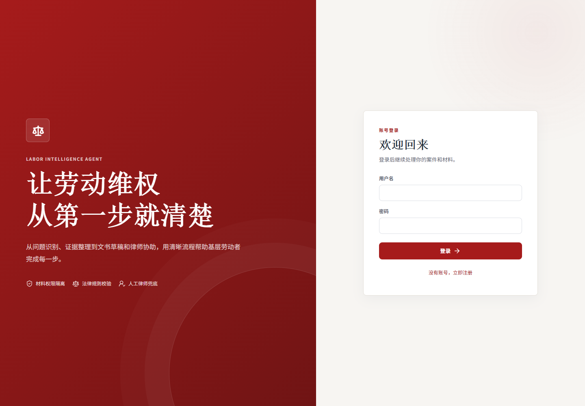
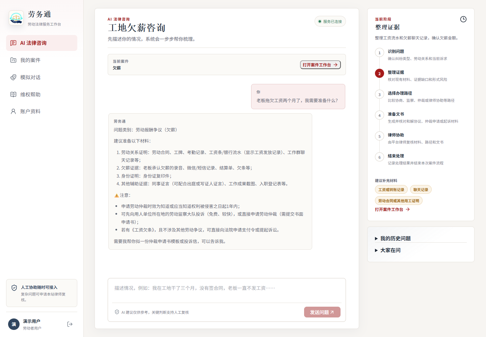
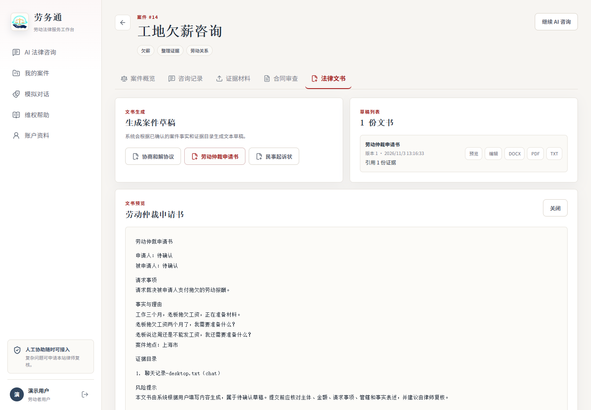
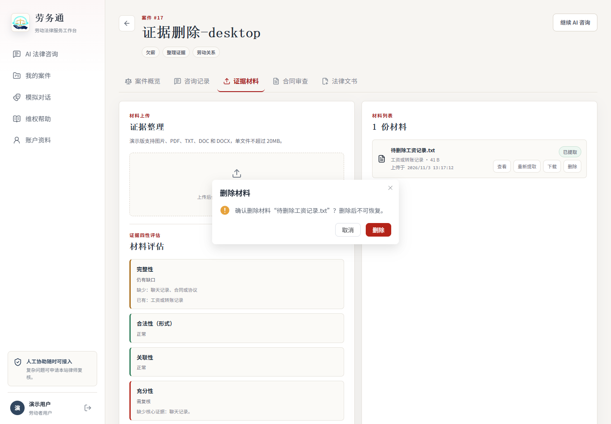
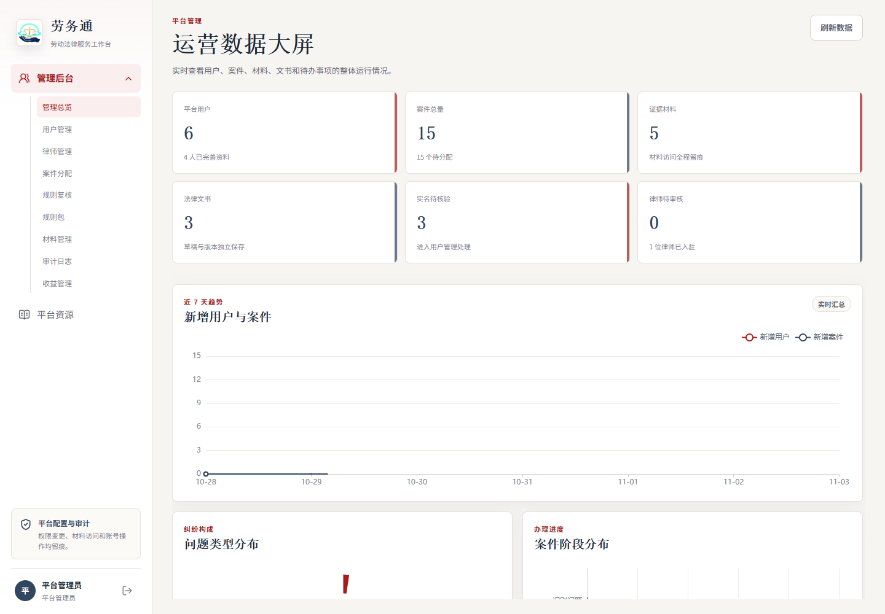
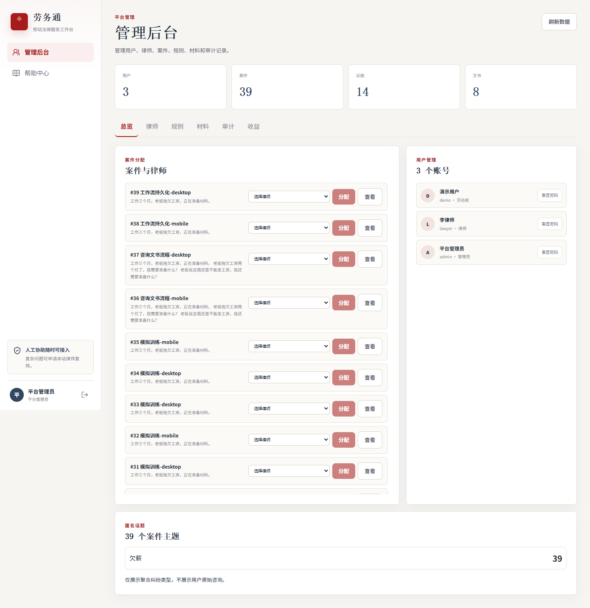
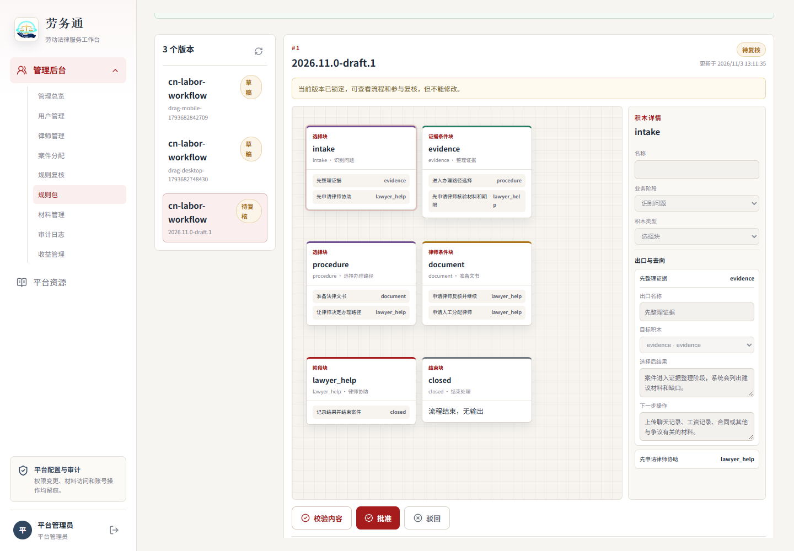
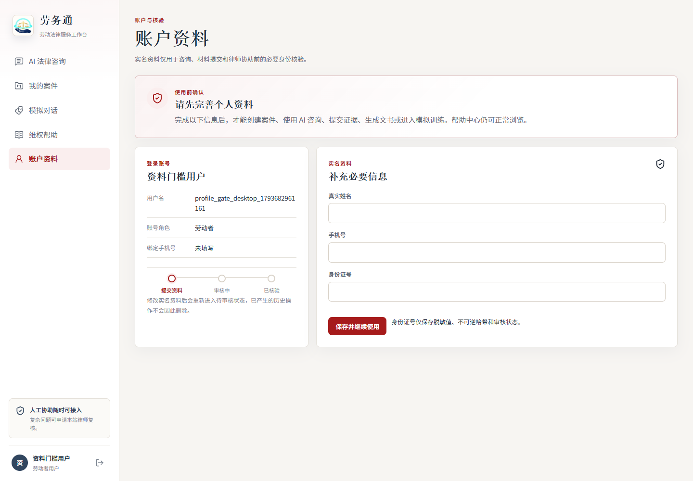
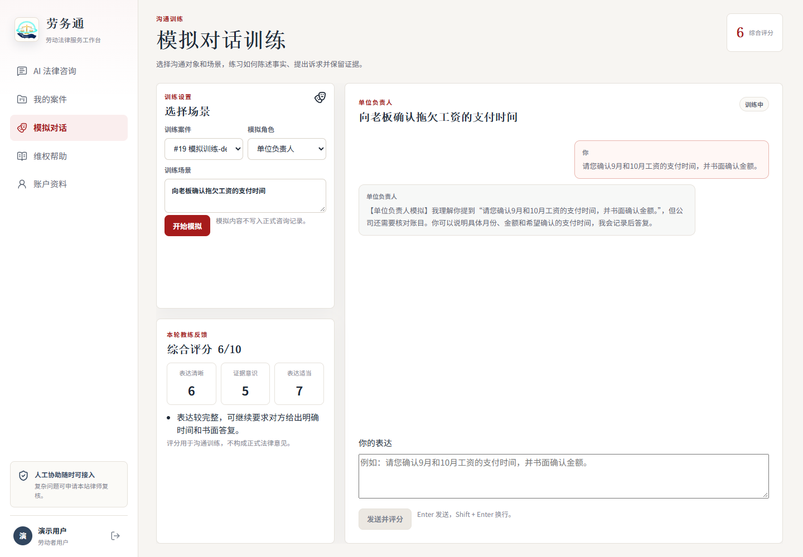
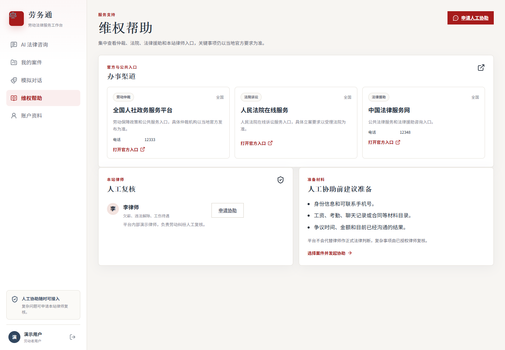

# Labor Intelligence Agent 0.2.0

面向基层劳动者的劳动纠纷法律服务平台。当前已完成可运行的业务 Demo，覆盖咨询、案件、证据、合同、文书和律师协作基础流程。

## 当前范围

- 中国法域、中文界面。
- Vue 3 + TypeScript 用户端、律师端和管理端。
- FastAPI 版本化 API、JWT 登录和角色权限。
- PostgreSQL/pgvector、Redis、Celery、MinIO 的开发环境配置。
- 浅色法律风格视觉基线。
- 统一红白法律品牌视觉，覆盖登录页、侧边栏和 favicon。
- 多轮 AI 咨询、案件上下文和本地演示规则。
- 证据上传、上传时间与在线预览、确认删除、PDF/DOCX 提取、四性评估和材料缺口提示。
- 合同文本风险审查和文件提取审查。
- 协商和解协议、仲裁申请书和民事起诉状草稿，支持 TXT/DOCX/PDF 导出。
- 律师意见、服务记录、收益台账和管理员分配。
- AI 角色模拟、评分、帮助目录、本站律师和匿名话题。
- 劳动者注册后先完善个人资料，再进入案件、咨询、材料、文书和模拟训练。
- 管理后台运营数据大屏，展示近 7 天趋势、纠纷构成、案件阶段和待办审计。
- 管理端规则包中心，支持纯中文 Excel 模板导入/导出、AI 辅助生成草稿、可视化拖拽组合、Word 复核稿、只读复核、结构校验、版本审核和发布切换。
- 登录后连续 20 分钟无操作会自动退出，并同步清理本地会话。
- 自动化测试、类型检查、静态检查和构建流程。

当前 AI 默认为本地演示规则；配置千问 API Key 后会调用真实模型。扫描版 OCR、在线支付、正式电子存证和公开律师市场仍属于后续或首期外范围。

## 演示账号

| 角色 | 用户名 | 密码 |
|---|---|---|
| 劳动者 | `demo` | `Demo123!` |
| 律师 | `lawyer` | `Lawyer123!` |
| 管理员 | `admin` | `Admin123!` |

演示账号仅用于本地开发，正式环境必须更换。

## 界面预览

以下截图取自当前 0.2.0 验证环境；桌面端按 1440×1000、移动端按 390×844 视口生成，长页面保留完整高度。

在线验证环境：<http://134.175.21.129:18080/>





















移动端预览：

- [登录页](docs/screenshots/login-mobile.png)
- [咨询工作台](docs/screenshots/workspace-mobile.png)
- [案件工作台](docs/screenshots/case-workspace-mobile.png)
- [证据删除站内确认](docs/screenshots/evidence-delete-confirm-mobile.png)
- [完善个人资料](docs/screenshots/profile-required-mobile.png)
- [运营数据大屏](docs/screenshots/admin-dashboard-mobile.png)
- [管理后台](docs/screenshots/admin-mobile.png)
- [规则包 Excel 与可视化配置](docs/screenshots/admin-rule-packages-mobile.png)
- [律师工作台](docs/screenshots/lawyer-mobile.png)
- [模拟对话](docs/screenshots/simulation-mobile.png)
- [维权帮助](docs/screenshots/help-mobile.png)

## 目录

```text
backend/   FastAPI 后端
frontend/  Vue 3 前端
infra/     Nginx 等基础设施配置
docs/      需求、架构和实施文档
```

## 文档

- [使用说明](使用说明.md)
- [文档中心](docs/README.md)
- [品牌资产说明](docs/brand/品牌资产说明.md)
- [用户使用手册](docs/user/用户使用手册.md)
- [律师使用手册](docs/lawyer/律师使用手册.md)
- [管理员使用手册](docs/admin/管理员使用手册.md)
- [规则包 Excel 填写说明](docs/admin/规则包Excel填写说明.md)
- [演示脚本](docs/demo/演示脚本.md)
- [当前功能与边界](docs/product/当前功能与边界.md)
- [两人并行开发约定](docs/development/两人并行开发约定.md)
- [分阶段分工与验收](docs/development/分阶段分工与验收.md)
- [法律内容迁移与责任边界](docs/development/法律内容迁移与责任边界.md)
- [开发与测试指南](docs/development/开发与测试指南.md)
- [安全与权限说明](docs/security/安全与权限说明.md)
- [部署与恢复](docs/deployment/部署与恢复.md)
- [API 概览](docs/api/API概览.md)
- [接口契约 v1](docs/api/接口契约_v1.md)
- [OpenAPI v1 JSON](docs/api/openapi.v1.json)

## 本地开发

### 后端

```powershell
cd backend
python -m venv .venv
.\.venv\Scripts\python -m pip install --upgrade pip
.\.venv\Scripts\python -m pip install -e ".[dev,quality]"
.\.venv\Scripts\python -m uvicorn app.main:app --reload --port 8000
```

如果使用的 IDE 或部署工具只识别 `requirements.txt`，可以改用：

```powershell
cd backend
.\.venv\Scripts\python -m pip install -r requirements-dev.txt
```

项目根目录也提供 `requirements.txt` 和 `requirements-dev.txt` 兼容入口。`pyproject.toml` 仍是主依赖声明。

### 配置千问

本地配置写入：

```text
backend/.env
```

```env
QIANWEN_API_KEY=你的千问API Key
QIANWEN_MODEL=qwen-plus
```

保存后重启后端。未配置 Key 或调用失败时会自动回退本地演示规则，不会导致咨询接口不可用。

访问：

- API 文档：<http://localhost:8000/docs>
- 健康检查：<http://localhost:8000/api/v1/health>

### 前端

```powershell
cd frontend
npm install
npm run dev
```

访问：<http://localhost:5173>

### 检查

```powershell
cd backend
.\.venv\Scripts\python -m pytest
.\.venv\Scripts\python -m ruff check .

cd ..\frontend
npm run test
npm run test:e2e
npm run typecheck
npm run build
```

Playwright 端到端测试复用本机 Microsoft Edge，不额外下载浏览器。

## Docker Compose

安装 Docker 后可在项目根目录运行：

```powershell
Copy-Item .env.example .env
docker compose up --build
```

当前机器未安装 Docker，因此 Compose 配置尚未在本机实际启动验证。

Compose 会启用 PostgreSQL、MinIO/S3 和 Celery；后端启动时会执行 Alembic 迁移，创建镜像后可用 `/metrics` 查看基础请求指标。完整部署、备份和恢复步骤见 [部署与恢复](docs/deployment/部署与恢复.md)。

隔离服务器环境已额外验证 PostgreSQL、Redis/Celery、MinIO、Nginx、非 root 容器、远程 Playwright 和数据库备份恢复。验证栈配置位于 `infra/validation/docker-compose.yml`。

## 安全约定

- 不提交 `.env`、真实密钥或用户材料。
- 生产环境必须更换 `SECRET_KEY`、数据库密码和 MinIO 凭据。
- 证据文件、实名信息和律师访问必须通过对象级权限和审计控制。
- AI 输出只作为辅助，不得直接决定案件状态或替代律师意见。

## 后续里程碑

1. 完善生产级 OCR、对象存储和异步任务。
2. 完善案件期限提醒和更细的纠纷规则。
3. 增加正式律师资质审核和运营流程。
4. 完成监控、备份恢复和部署验证。
